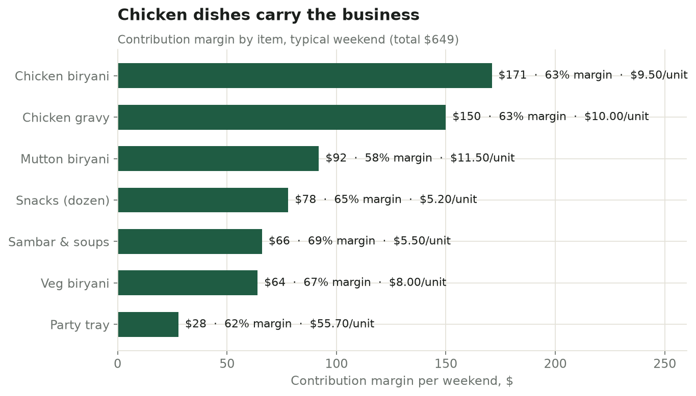
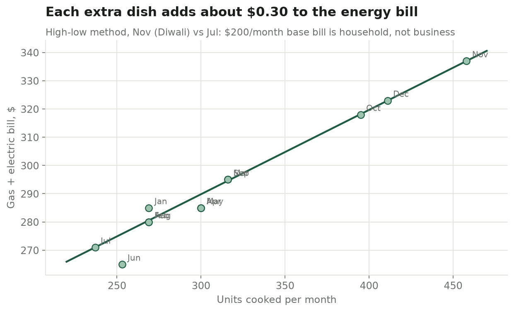
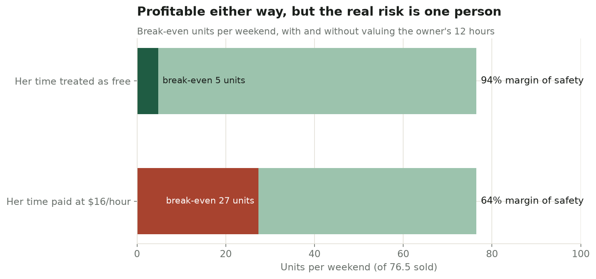
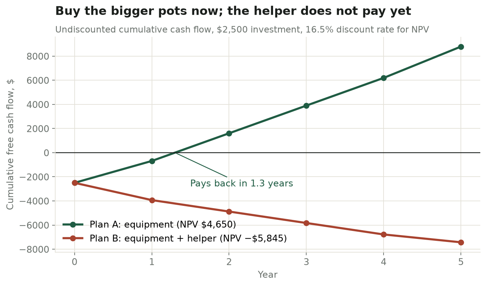
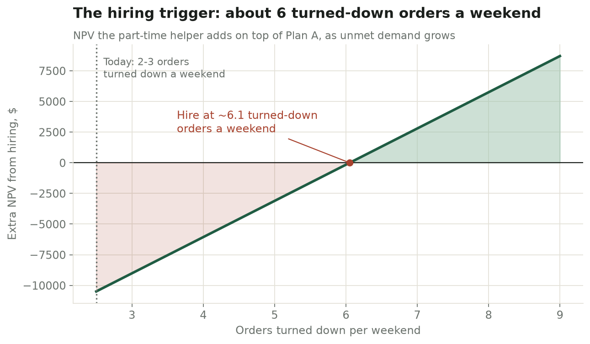

# Pravik's Kitchen: Unit Economics and a Capacity Investment Decision

**A one-person home food business sells out every weekend and turns customers away. Should it buy bigger equipment, hire help, or both?**

Pravik's Kitchen is my mother's weekend business: home-cooked South Indian food (biryanis, chicken gravies, vadas, sambar) sold by WhatsApp order in New Jersey. She cooks alone for about 12 hours each weekend, and her main dishes sell out almost immediately. This project prices every menu item, separates fixed from variable costs, finds the break-even, and values two ways to add capacity.

> Individual project, Cost & Managerial Analysis (FIN-1759), Hult International Business School, November 2026. The business keeps no written records, so **every price, cost and volume here is my estimate**, calibrated to the roughly $1,000 she takes in on a normal weekend. The Python model reproduces the submitted Excel workbook exactly, and the tests check every headline number.

---

## Key findings

| | |
|---|---|
| **63% contribution margin** | Each item sold contributes $8.48 on average. Chicken biryani and chicken gravy earn the most per weekend. |
| **Break-even at 5 items a weekend** | Out of 76.5 sold: a 94% margin of safety. Paying her time at $16/hour moves break-even to 27 items (64% margin). |
| **She earns ~$51 per hour of her time** | $31,646 a year of operating income before valuing her hours. |
| **Buy the equipment: NPV +$4,650** | $2,500 of bigger-batch equipment wins back turned-down orders. IRR 79%, payback 1.3 years, still +$3,173 with 20% fewer orders. |
| **Wait on the helper: NPV −$5,845** | A part-time helper pays off once she is turning down about **6 orders a weekend** (2–3 today). |



## Cost behaviour

Cooking at home with cash and Zelle payments means almost no fixed costs: no rent, no staff, no card fees. The one mixed cost is the household gas and electric bill. I split it with the **high-low method**, comparing November (Diwali, the busiest month) with July (the quietest, when many families travel):

> Variable cost = ($337 − $271) ÷ (458 − 237 units) = **$0.30 per dish**. The remaining ~$200/month is the household's base bill, which exists whether she cooks or not, so it is excluded from the business.



| Item | Price | Variable cost | CM per unit | CM ratio | Per weekend |
|---|---|---|---|---|---|
| Chicken biryani (quart) | $15.00 | $5.50 | $9.50 | 63% | 18 |
| Mutton biryani (quart) | $20.00 | $8.50 | $11.50 | 58% | 8 |
| Veg biryani (quart) | $12.00 | $4.00 | $8.00 | 67% | 8 |
| Chicken gravy (quart) | $16.00 | $6.00 | $10.00 | 63% | 15 |
| Vadas, bajjis, pakodas (dozen) | $8.00 | $2.80 | $5.20 | 65% | 15 |
| Sambar, rasam, chutney (quart) | $8.00 | $2.50 | $5.50 | 69% | 12 |
| Made-to-order party tray | $90.00 | $34.30 | $55.70 | 62% | 0.5 |
| **Weighted average** | **$13.42** | **$4.94** | **$8.48** | **63%** | **76.5** |

## Break-even: the hidden cost is her time



The accounts make the business look nearly risk-free, but they treat 12 hours of her work every weekend as free. Valued at $16/hour (New Jersey part-time kitchen pay; the 2026 state minimum wage is $15.92), that is $9,984 a year, five times the other fixed costs combined. The business can survive a slow season. What it cannot survive is her stopping.

## The investment decision

The constraint is capacity, not demand: she turns down 2–3 orders a weekend. Most of her time goes into watching each batch, not into how much is in the pot, so a pot twice the size takes about the same time.

| | Plan A: bigger-batch equipment | Plan B: equipment + part-time helper |
|---|---|---|
| Upfront | $2,500 (pots, burner, rice cooker, carriers, fridge, prep table) | Same |
| Annual | +$300 propane and upkeep | + $4,992 helper (6 h/weekend at $16), +12 party trays a year |
| NPV at 16.5% | **+$4,650** | **−$5,845** |
| IRR / payback | 79% / 1.3 years | n/a / never within 5 years |
| Decision | **Accept** | **Reject for now** |

**Discount rate (16.5%):** 4.5% risk-free + 5% equity premium + 3% small-company premium + 4% because the whole business depends on one cook selling only on weekends. Five-year life, straight-line depreciation, $300 resale, 25% tax, 80% of turned-down orders won back in year 1.





**Recommendation:** buy the equipment now; it pays for itself in under two years and stops her turning people away. Hire a part-time helper once she is turning down about six orders a weekend, or sooner if the 12 hours alone start to wear on her. Each hour she gets back is worth about $51 of profit, against a $16 helper wage.

## Repository

```
src/model.py          every input (clearly marked as estimates) and the calculations
src/make_charts.py    builds charts/*.png and results.json
tests/test_model.py   checks the Python model against the submitted Excel workbook
```

```bash
python3 -m pip install -r requirements.txt
python3 src/make_charts.py
python3 -m unittest -v tests/test_model.py
```

## Limits

- All inputs are my estimates from watching the business run, not bookkeeping records.
- The high-low split rests on two estimated months, and July includes air conditioning, so weather blurs it.
- Win-back rates and the helper's extra output are assumptions; the 20%-fewer-orders case shows the equipment decision holds even if they are optimistic.

---

**Vikram Manisankar** · [Portfolio](https://vikrammanisankar26-cpu.github.io) · [LinkedIn](https://www.linkedin.com/in/vikram-manisankar)
